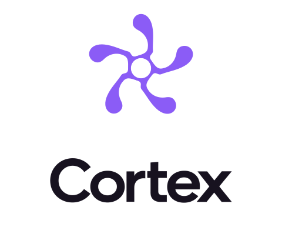
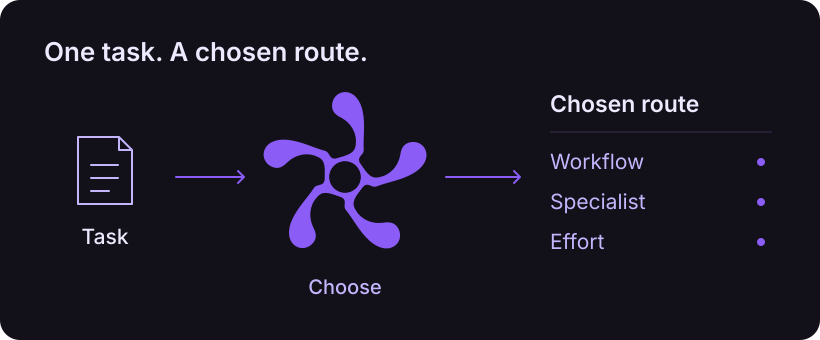

<div align="center">

<h1>
  <picture>
    <source media="(prefers-color-scheme: dark)" srcset="assets/cortex-logo-light.svg" />
    
  </picture>
</h1>

**Choose the workflow before your coding agent starts building.**

Cortex gives your coding agent a repeatable way to choose a workflow, specialists and effort level, then record the decision and outcome.

[](#quick-start)
&nbsp;[](#using-cortex-with-other-agents)
&nbsp;[](LICENSE)



[Quick start](#quick-start) · [See an example](#a-routing-example) · [How it works](#how-it-works) · [Documentation](#documentation)

</div>

Cortex is **Markdown instructions plus a Python CLI**. Your coding agent follows the instructions to choose how to approach a task. The CLI keeps a local record of its choices, retrieves past routes and helps you review what happened. The core protocol runs with your existing agent and local tools; the optional hosted adviser is off by default.

## A routing example

You ask your agent to refactor authentication middleware. Before implementation, it declares a route and explains the verification it needs:

```text
Direct > plan-and-verify @ L3

Reason: changing authentication behavior needs a plan and a verifier pass.
```

The agent logs that decision, does the work and records the outcome. You can inspect the route later or redirect it while the work is underway.

This is an illustrative example. The route depends on the capabilities available in your session and the work you request. Cortex does not execute the workflow itself or automatically switch models.

<a id="why-this-exists"></a>

## When Cortex helps

Cortex is useful when you already use several agent workflows and want a consistent way to choose among them.

| When you ask for… | The protocol helps your agent… |
| --- | --- |
| A small fix | Keep the approach proportional and use a focused check. Trivial edits skip the full routing ceremony. |
| A risky refactor | Explain why deeper planning and verification are needed. |
| Work across design, backend or other disciplines | Use available specialists for independent concerns and reconcile their results. |
| A review of past decisions | Inspect the chosen workflows, effort levels, corrections and outcomes. |

Start with the tools you already have. You can add workflow systems to your registry as you adopt them.

<a id="install"></a>

## Quick start

The guided path below is for **Claude Code on macOS or Linux**, with Python 3 and Git available. For other agents, see [integration options](#using-cortex-with-other-agents).

**1. Install the instructions, CLI and skills.**

```bash
git clone https://github.com/amitvijapur/cortex.git
cd cortex
./install.sh
```

The installer preserves an existing `cortex.md` and checks for skill conflicts before copying. See [what gets installed](docs/setup.md) for destinations, custom paths and conflict handling.

**2. Activate Cortex and build your registry.**

Add `@cortex.md` once to `~/.claude/CLAUDE.md`, preserving your existing instructions. Start a fresh Claude Code session, then run:

```text
/cortex-init
```

The skill discovers your tools, asks about ambiguous choices and proposes a Workflow Registry. It backs up an existing registry and asks for confirmation before writing changes. Only register capabilities your session can actually use.

`/cortex-init` is an agent-led setup skill. The Python command `cortex init` performs discovery only.

**3. Check setup and try one task.**

```bash
python3 ~/.claude/bin/cortex doctor --no-probe
```

Resolve any setup issues it reports. Then ask your agent:

```text
Review the error handling in this project. Follow Cortex, use only available
capabilities and record the outcome when finished. A direct review is fine.
```

Before the review, look for a declared workflow, effort tier and reason. After it finishes, inspect the record:

```bash
python3 ~/.claude/bin/cortex show --last 3
```

Your task should appear with its route, effort level and outcome. If it does not, check that the instructions loaded and the agent used the CLI. [Setup and troubleshooting →](docs/setup.md)

## How it works

For non-trivial tasks, the agent follows a short protocol:

1. **Understand the task and choose the rigor.** Classify the work and decide how much planning and verification it needs.
2. **Choose an available workflow.** Consult past routes, pick appropriate tools and specialists, then declare and log the decision before implementation.
3. **Do the work and record the result.** Capture the outcome and any correction so you can review the choice later.

| Tier | Approach | Verification |
| --- | --- | --- |
| **L1 · Reflex** | Direct action for trivial work | Focused check |
| **L2 · Standard** | A bounded workflow, the default | Spot-check |
| **L3 · Deep** | Plan and verify | Verifier pass |
| **L4 · Max** | Iterate until verified | Full verification loop |

Tiers describe rigor, not provider models. Parallel work depends on independent concerns and available agents. More specialists do not automatically mean a higher tier. [Routing rules and full protocol →](docs/routing.md)

<a id="what-it-costs-you-in-context"></a>

The instructions occupy context whenever your agent loads them. Keep the registry focused, retain a short routing index and load detailed system notes on demand. [Registry design and context overhead →](docs/registry.md)

<a id="the-self-learning-loop"></a>

## Outcome history

Routes, outcomes and corrections are separate events in a local, append-only log. You can inspect what the agent first chose and how that choice changed.

`hint` retrieves recent distinct routes as evidence for the next decision. `learn` identifies recurring patterns and proposes registry changes for review. Outcomes inform the reader; they do not train a model or rank the hints. Registry improvements require your approval. [History, hints and reviewed learning →](docs/history.md)

## Using Cortex with other agents

The protocol can be adapted to agents that read instruction files and can run the CLI. Setup differs by host:

| Agent | Setup path |
| --- | --- |
| **Claude Code** | Guided `/cortex-init` setup; framework loaded from `CLAUDE.md`. |
| **Codex** | Manual `AGENTS.md` integration. Existing Codex homes also receive log, learn, reroute and delegation skills. |
| **Cursor, Gemini CLI, Aider, Windsurf** | Manual integration through the agent's rules or instruction configuration. |

The installer currently provides the initialization skill to Claude Code only. A registry entry must match tools that are callable in the current host. [Other-agent setup and shared state →](docs/setup.md#other-agents)

## Checking the router

Cortex includes checks for protocol adherence, routing consistency and agent retrieval. They can expose drift between a declared route and recorded behavior.

These checks catch regressions. They do not establish that a route was optimal, that Cortex saves tokens or that it improves delivery speed. The core protocol relies on the host agent following its instructions. [Evaluation methods and limits →](docs/evaluation.md)

<a id="cli-reference"></a>
<a id="the-stack-cortex-routes-between"></a>
<a id="building-your-own-registry"></a>
<a id="repo-layout"></a>

## Documentation

| Guide | What you will find |
| --- | --- |
| [Setup](docs/setup.md) | Install destinations, other agents, custom state, troubleshooting and the optional session-start audit. |
| [CLI reference](docs/cli.md) | Logging, hints, outcomes, corrections, history and checks. |
| [Routing](docs/routing.md) | Protocol, calibration, parallel work and capability boundaries. |
| [Registry](docs/registry.md) | Adding workflows, managing context and ecosystem examples with credits. |
| [History and learning](docs/history.md) | Event schema, corrections, hints and reviewed proposals. |
| [Evaluation](docs/evaluation.md) | What the checks measure, their limits and rejected experiments. |

Optional resources include the [Jev routing adviser](docs/jev-adviser.md), which is off by default and has [no demonstrated routing advantage in the local pilot](docs/jev-pilot-results.md), [skill-use evidence](docs/skill-evidence.md), and the [Frontend Design Library](frontend/README.md).

## Contributing

Issues and pull requests are welcome. Include a concrete task, the expected behavior and what you observed. For documentation changes, check local links and keep examples consistent with the CLI. For routing changes, read [the routing guide](docs/routing.md) and run the relevant [evaluation checks](eval/README.md).

Maintainers can find the running work log and lessons in [maintainer notes](docs/maintainers/README.md).

## Credits

Cortex routes between tools built by their own maintainers. The [ecosystem examples and credits](docs/registry.md#ecosystem-examples) link to those projects. They are optional examples you can adapt to your own setup.

## License

[MIT](LICENSE). Use it, fork it and adapt it to your workflow.
