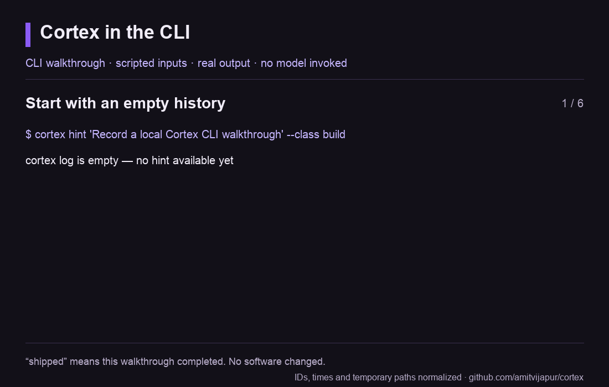

# A real CLI walkthrough

**CLI walkthrough · scripted inputs · real output · no model invoked**



This animation renders output captured from real local subprocess commands. The
script supplies the task, route and reasoning. It does not ask an agent or model
to select them. The task is **“Record a local Cortex CLI walkthrough”**, and its
explicit route is `Direct > cli-walkthrough @ L2`. No specialist is invoked.

The final `shipped` event means **the CLI walkthrough completed**. It does not
claim that an agent implemented a feature, fixed a bug, or successfully changed
software. The outcome note records that distinction in the actual event history.

## What happens

[`scripts/record_demo.py`](../scripts/record_demo.py) performs these operations:

1. Creates a fresh state directory and a disposable project inside a Python
   `TemporaryDirectory`. On macOS the temporary root is explicitly `/private/tmp`.
2. Runs `hint` and verifies that no historical routes exist.
3. Runs `log-line` with the scripted task, route, effort reason and project label.
4. Reads the resulting JSONL route record and verifies its persisted fields.
   A separate Python subprocess extracts its exact generated `event_id`.
5. Runs `show` and verifies that the route is visible before it has an outcome.
6. Appends `outcome shipped --ref <route-id>` with the walkthrough-only scope note,
   then verifies that the original route bytes were preserved and exactly one
   outcome event was appended against that ID.
7. Runs `show` and `history`, verifying that both expose the recorded completion.

There are seven actual subprocess commands, six of which appear in the animation.
The intermediate Python command that extracts the exact route ID is included in
the machine-readable capture. Each child receives only `PATH`, `LANG` and a
disposable `CORTEX_HOME`; agent identity variables, API credentials and personal
configuration are not inherited. The script does not reassign `HOME` or
`CODEX_HOME`, contact a model provider, or write to the user's routing history.
The temporary project and its log are removed when the script exits.

`cortex` in the recording is a display alias for the current Python interpreter
running this checkout's `bin/cortex` by absolute path with bytecode writing disabled. Commands actually execute
from the disposable project, rather than from a user's working project.

## Inspect the capture

[`examples/demo-session.json`](../examples/demo-session.json) preserves each
command's arguments, exit code, standard output and standard error. The `log-line`
confirmation comes from standard error; the animation presents it as readable
command output. Display wrapping and the labels surrounding the output are
presentation only. There is no simulated typing, fake dashboard or fabricated
success message.

The following replacements remove transient identifiers and filesystem details
from the public capture without changing the CLI's messages:

| Placeholder | Replaces |
| --- | --- |
| `<route-id>` | The exact generated route event ID, consistently used in the outcome command and history |
| `<run-id>` | The random ID for a CLI invocation |
| `<demo-project>` | The canonical path of the disposable project |
| `<time>` | The UTC date and minute printed by the CLI |

One optional process-provenance line is omitted rather than replaced. The CLI
prints `session_ref: ppid_<10 hex>` only when its local `ps` probe can determine
the parent process start time. That probe can succeed on hosted Linux or macOS CI while being
unavailable in a local sandbox. The recorder removes only the complete history
line matching that exact fallback format. It first verifies that the raw route
has no host identity and has either no session or a valid process-derived
fallback. Native agent session identities and arbitrary session values are not
normalized away. The omission is recorded explicitly in the capture metadata.

The JSON records the SHA-256 of the CLI used to create the capture. It contains
no private project, agent-session or account provenance. The checked-in animation
is 1100 × 700 pixels, six paced frames, 31.5 seconds per loop and about 186 KB.
Its violet and dark palette matches the repository. Frames were visually checked
for clipping and legibility, including the longest command and event history.

## Replay and verify

From the repository root, with Python 3.11 or newer available:

```bash
python3 scripts/record_demo.py --check
```

This uses only the Python standard library. It replays the real commands in fresh
disposable state, verifies the stored route and append-only outcome behavior,
and compares the normalized observed transcript against the checked-in capture.
It then repeats the real CLI walkthrough with isolated `ps` stubs that return a
parent start time or fail, checking that both availability states preserve the
same captured command/output contract. Each fixture also verifies the raw
session identity is present or absent as intended. A mismatch reports the affected step and
field, with a captured-versus-observed diff.
It does not overwrite that historical capture or regenerate the GIF. The check
verifies the recorded command/output contract, rather than claiming identical
historical timestamps or random IDs. It makes no model calls and incurs no model
spend.

To intentionally refresh the capture:

```bash
python3 scripts/record_demo.py
```

To refresh both the capture and animation, use a Python environment with the
optional Pillow package and an Arial or DejaVu Sans font available:

```bash
python3 scripts/record_demo.py --gif
python3 scripts/record_demo.py --check
```

The verified GIF export used Pillow 12.3.0 and Arial on macOS. Fonts and Pillow
are export dependencies only; Cortex and the standard-library replay check do
not require them. Rendering may vary across font installations. Inspect the
animation again after an intentional regeneration.

## What this demonstrates

The recording demonstrates local evidence retrieval, route recording, explicit
outcome references and append-only history. It does not measure routing quality,
prove an agent followed its declared workflow, demonstrate installation or
registry discovery, or establish savings in cost or time. A future captured
agent-led task can demonstrate those additional interactions once it has actual
execution evidence.
