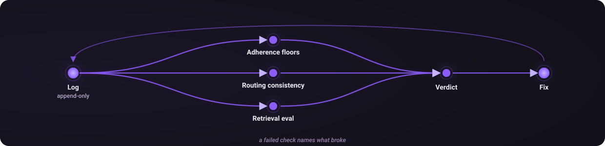

# What the checks prove, and what they don't

The [README](../README.md#checking-the-router) introduces the evidence layer. This guide explains the checks and their limits. For script-level details, replay experiments and retrieval findings, see [`eval/README.md`](../eval/README.md).

A declared routing line is generated text. It can remain persuasive while the behavior underneath drifts. The checks make parts of that gap observable; they do not establish that a route was optimal.

<p align="center"></p>

## Adherence

`eval/score_adherence.py` scores recorded protocol behavior against floors in [`eval/adherence-thresholds.json`](../eval/adherence-thresholds.json), including declared tiers, hints before routes and recorded outcomes.

```bash
python3 eval/score_adherence.py --check
python3 eval/score_adherence.py --summary
```

`--check` exits non-zero when a gated metric breaches its floor. A passing report covers what its log and attribution inputs can establish. It does not prove every instruction was followed in every transcript. Optional [Codex command attribution](codex-attribution.md) checks ownership of recorded commands rather than full-task success.

## Routing consistency

`eval/route_eval.py` asks a headless session to route a task, captures the declaration and asserts a property of it. Start without model calls:

```bash
python3 eval/route_eval.py --dry-run
```

A real run invokes models and can spend money. Run it only with authorization and an appropriate spend ceiling.

| Case kind | What it checks |
|---|---|
| `canary` | Recall of an example visible in the protocol, useful for detecting loading failures |
| `rule` | Application of a rule to a task that is not a worked example |
| `paired` | A directional property between a base task and a transformed version |
| `shape` | Whether the domain-breadth heuristic selects multiple lanes |

Paired cases always receive their own sessions so an earlier answer cannot anchor a later comparison. The harness redirects `CORTEX_HOME` to a sandbox to keep test routes out of the live log. It records model and document identity; changed documents or execution conditions make comparisons different experiments. Repeats estimate stability, not additional independent cases.

## Retrieval

Agent retrieval evaluation uses a sealed train/test split with hard negatives from the same division as the target. Comparing a security specialist with a marketing specialist would make the problem artificially easy. Mined `(task, agent)` pairs begin as an unlabelled worksheet because historical selections may be wrong or salience-driven.

Hint evaluation replays queries chronologically using only earlier routes. Proposed retrieval changes must be compared with a simple recency baseline on the same denominator. Outcomes and historical agreement are evidence to review, not labels proving that the selected route was best.

## Local behavioral checks

```bash
PYTHONDONTWRITEBYTECODE=1 python3 eval/test_cortex_cli.py
```

This uses the script's own runner and temporary fixtures. Run it after CLI changes. It verifies CLI behavior without a paid model evaluation. Optional adviser experiments have a separate [Jev evaluation contract](jev-evaluation.md); synthetic plumbing tests do not establish live routing benefit.

---

## What this does not establish

These tests answer *"did something break?"*, not *"was that a good route?"* There is no oracle for routing quality here, and building one needs labelled data that does not exist yet. A suite that quietly grew into a quality claim would be exactly the false assurance this was built to remove.

**The floors are targets, not pre-registrations.** They were chosen with the current numbers visible, which the thresholds file admits in its own header, and they sit *below* where the system runs today so they catch regression rather than certifying the present as good. **A floor is not a goal** either: `hint_before_route` floors at 25% against a target of 60%, and 25% is not an endorsement of 29%.

---

## What the harness has rejected

A test suite that has never contradicted its author is decoration. Two changes were built, evaluated, and then dropped on the evidence:

- **A tuned BM25F ranker for agent retrieval.** It beat the baseline on the development set, then lost on held-out data. The corpus hygiene fixes shipped; the ranker did not.
- **An earlier capability-confinement layer for the intake worker.** This iteration was built and removed after its operational restrictions broke credentials and plugin hooks. Its correctness checks retained the requirement for content-bound approval and evidence that a target actually changed. This is a historical design decision, not the current intake security or deployment contract. Later repair work introduced separate operational gates; consult [intake operations](intake-operations.md) before operating that service.

The harness has also caught a defect in itself. Changing a default ranker silently rewrote what every evaluation row was measuring, because no result recorded which ranker produced it. Rankers are now named explicitly at the call site.
