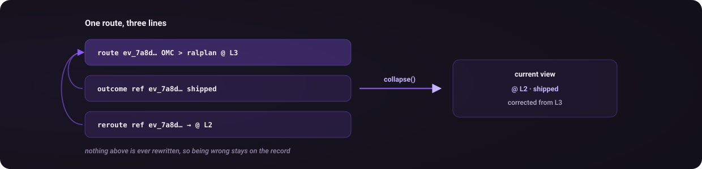

# Routing history and learning

Cortex records decisions so an agent and its user can inspect what was chosen, what changed and how the work ended. It retrieves evidence and proposes shortcuts. It does not automatically retrain a model or rewrite your registry.

## Append-only events

The default log is `~/.claude/cortex-log.jsonl`, or `<state-dir>/cortex-log.jsonl` with a [custom state directory](setup.md#custom-state-directory). Each line is a JSON event. A routing decision writes a `route`; an outcome, reroute or tier reclassification writes a separate event referencing that route. The original row is preserved.

This abridged example illustrates the event relationship; actual events also contain timestamps, identity and provenance fields:

```json
{"event":"route","event_id":"ev_7a8d080fc1f5","task":"Refactor auth middleware","class":"build","system":"Direct","pattern":"plan-and-verify","tier":"L3","tier_reason":"Session compatibility needs an independent verification pass","route_confidence":"high","tier_confidence":"med","spec_confidence":"high"}
{"event":"outcome","event_id":"ev_3a664b902d4d","ref":"ev_7a8d080fc1f5","outcome":"shipped"}
```

<p align="center"></p>

The CLI derives the current view by replaying these events. `show`, `hint`, `learn`, `audit-tiers` and `doctor` share that collapsed view. `history <event_id>` displays the chain so the first decision remains inspectable after a correction. Historical rows without an `event` key are read as routes.

Keeping the initial decision matters for evaluation. Mutating it would change a baseline over the same original rows without preserving what had changed.

## Route identity and corrections

A route has a canonical event ID. Display project names are labels; directory and session identity determine the default target of outcome and reroute commands. An automatic update selects the latest route in the current canonical working directory and agent session. It does not fall back to another project or session, and a partial route can receive a later outcome.

For older routes or a shell without session identity, inspect `cortex history <task_hash>` and use the exact route ID with `--ref`. Ambiguous legacy references are reported and left unapplied. See the [CLI recipes](cli.md#record-outcomes-and-corrections).

`reroute --to "replacement route"` records that the previous choice was corrected. A subsequently logged route can reference its predecessor with `--redirect-from`. Reclassification also appends an event, preserving the original tier. Neither operation erases the original reasoning.

## What hints do

`hint "task" --class build` retrieves the most recent distinct `(system, pattern, tier)` routes in the selected pool. The default is five. Similarity and outcomes are displayed for the reader; they do not weight the ranking. `--min-similarity` is an optional narrowing filter.

A new installation reports that no history is available. There is no route-count gate before the command can run. More history expands the evidence pool, but a past successful outcome does not prove that its route was optimal for that task or a new one. Inspect corrected, partial and abandoned outcomes as well.

## What learning does

`learn` groups non-corrected routes by `(class, system, pattern)` and surfaces tuples repeated at least three times by default. It can write Markdown shortcut proposals to `<state-dir>/cortex-proposals/`. If `CORTEX_OBSIDIAN_ROOT` is set, proposals go to that directory's `proposals/` instead.

Review a proposal, then approve, modify or reject it. The CLI does not apply the shortcut to `cortex.md`. Proposals with frontmatter status `approved`, `rejected` or `superseded` are treated as actioned; `--include-actioned` brings them back into reports. `--no-proposals` reports without creating proposal files.

The original framework describes four phases. They are useful categories of behavior, not four capabilities automatically proven active for every installation:

| Category | Available behavior | What it requires |
|---|---|---|
| Visibility | Record and inspect routing decisions | Routes actually logged by the agent |
| Pattern surfacing | Find repeated tuples and propose shortcuts | Enough repeated routes to meet the configured threshold |
| Historical evidence | Retrieve recent distinct routes | Relevant history and the reader's judgment |
| Outcome and correction capture | Append outcomes and changes | The agent or user records what happened |

A setup audit may print phase labels based on route counts. Those labels do not establish better routing, automatic learning or outcome quality. [Evaluation](evaluation.md) explains what the available checks can establish.

## Optional skill evidence

The opt-in [skill-use evidence](skill-evidence.md) layer links a route to self-reported skill reads, invocations or applications using canonical paths and content hashes. This supports inspection of claimed use. It does not observe all skill activity or prove successful application.
