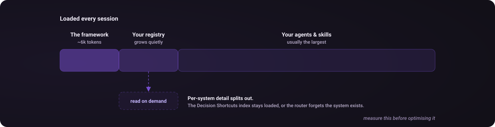

# Build your workflow registry

Cortex routes among tools you already have. A useful registry describes what is callable, when to choose it, and what evidence should change that choice. The ecosystem catalogue below is a set of examples and credits, not an installation checklist.

## Start with your available tools

The shipped [`templates/cortex.md`](../templates/cortex.md) contains the routing framework, registry placeholders and an OMC worked example. [`examples/cortex.md`](../examples/cortex.md) shows a populated personal registry. Both need review against your actual tools and permissions. Do not copy a route that assumes an unavailable specialist, council or command.

Claude Code's `/cortex-init` skill scans your setup, resolves ambiguities and proposes a registry merge with backup and confirmation. The CLI's `cortex init` only performs discovery. See [setup](setup.md#discovery-versus-registry-generation) for the distinction and other-host setup.

For a manual registry, describe each system with:

- Its name and whether it is installed and callable.
- One line describing its strengths.
- One line describing the tasks it is best suited to.
- A small `Pattern | Use When` table using actual available commands.
- A row in **Decision Shortcuts** connecting a task type to a default route and tier.

Start small. A host's normal execution tools can be the only available workflow. For example, this shortcut describes a bounded task without assuming an orchestrator is installed:

| Task type | Default route | Tier |
|---|---|---|
| Small reversible edit with a clear acceptance check | Direct > bounded-edit | L2 |

Default shortcuts guide judgment; they do not waive authorization or prove that a tool is available in a particular session. Keep the L2 default unless a concrete risk or verification need warrants more rigor. A route naming a council still requires that council to be callable and its paid spend authorized.

When adding a tool, ask the agent to draft its entry and shortcut using the current capability inventory. Review what changed before replacing a personalized registry. A CLI scan detects configuration, not necessarily working credentials or session access.

## Context cost

The full framework and anything loaded alongside it consume context before work begins. The earlier README estimated the shipped template at roughly 6,000 tokens. That is an approximate historical figure, not a fixed token count across tokenizers or future revisions. Measure your loaded setup rather than assuming the template is the largest component.

Keep the **Decision Shortcuts index loaded**. Move long pattern tables, setup notes and caveats into files the agent can read on demand. Each shortcut should retain enough information to identify the system and know when its detail is relevant.

Moving the index out can make a system unreachable: the router never sees it, never chooses it, and its zero usage later looks like evidence that the tool was unnecessary. A previous personal registry audit found eight unused entries among 154 decisions, but usage alone did not establish whether those entries were installed and reachable. [`eval/registry_reachability.py`](../eval/registry_reachability.py) separates those questions.

Agent and skill descriptions can dominate the same context budget. Count those as well before optimizing the registry.

## Ecosystem examples

The following projects appeared in the original personal registry. Their links are retained to credit their maintainers and illustrate possible categories. Availability, current features, compatibility and project status must be checked before adoption. Cortex does not install this catalogue or certify these integrations.

### Orchestration

| Project | Example registry role |
|---|---|
| [oh-my-claudecode](https://github.com/Yeachan-Heo/oh-my-claudecode) | Multi-agent orchestration and planning workflows such as `ralplan`, `autopilot`, `ralph`, team execution and council review, where exposed by the host |
| [GSD](https://github.com/open-gsd/gsd-core) | Phase-based project planning and execution |
| [claude-plugins-official](https://github.com/anthropics/claude-plugins-official) | Feature development, review and security workflow plugins |

### Quality checks

| Project | Example registry role |
|---|---|
| [LLM Council](https://github.com/karpathy/llm-council) | Multi-model answering, cross-review and synthesis pattern |
| [adversarial-spec](https://github.com/zscole/adversarial-spec) | Review a specification or API contract before implementation |
| [gitleaks](https://github.com/gitleaks/gitleaks) | Deterministic secret scanning |
| [defending-code reference harness](https://github.com/anthropics/defending-code-reference-harness) | Security analysis and patching workflows |

### Knowledge and search

| Project | Example registry role |
|---|---|
| [Graphify](https://github.com/Graphify-Labs/graphify) | Knowledge graphs across code, documents and other content |
| [Understand Anything](https://github.com/Egonex-AI/Understand-Anything) | Codebase knowledge graphs and architecture exploration |
| [claude-mem](https://github.com/thedotmack/claude-mem) | Cross-session memory |
| [Context7](https://github.com/upstash/context7) | Library documentation lookup |
| [Exa](https://github.com/exa-labs/exa-mcp-server) and [Firecrawl](https://github.com/mendableai/firecrawl-mcp-server) | Web discovery and page extraction |
| [Scrapling](https://github.com/D4Vinci/Scrapling) | Page scraping and extraction |
| [last30days](https://github.com/mvanhorn/last30days-skill) | Recent online discussion and research |

### Specialists and skills

| Project | Example registry role |
|---|---|
| [Agency Agents](https://github.com/msitarzewski/agency-agents) | A pool of domain specialists |
| [anthropics/skills](https://github.com/anthropics/skills) | Document creation and reusable agent skills |
| [knowledge-work-plugins](https://github.com/anthropics/knowledge-work-plugins) | Data, legal, search and other knowledge-work plugins |
| [claude-tag-plugins](https://github.com/anthropics/claude-tag-plugins) | Service connector plugins |
| [financial-services](https://github.com/anthropics/financial-services) | Financial analysis and deliverable workflows |
| [Tessl](https://tessl.io/) | Framework and library guidance |
| [obsidian-skills](https://github.com/kepano/obsidian-skills) | Obsidian vault operations |
| [awesome-design-md](https://github.com/VoltAgent/awesome-design-md) | Reference design specifications |
| [Hyperframes](https://github.com/heygen-com/hyperframes) | HTML-based video production |

### Domain models

| Project | Example registry role |
|---|---|
| [Kronos](https://github.com/shiyu-coder/Kronos) | Financial time-series modeling, with validation appropriate to the use case |
| [QuantMind](https://github.com/LLMQuant/quant-mind) | Structured financial research retrieval |

### Infrastructure

| Project | Example registry role |
|---|---|
| [Morph](https://www.morphllm.com/) | Code editing and search |
| [DuckDB MCP](https://github.com/motherduckdb/mcp-server-motherduck) | SQL analysis over local data |
| [Chrome DevTools MCP](https://github.com/ChromeDevTools/chrome-devtools-mcp) | Browser inspection, performance analysis and visual checks |
| [Toolport](https://github.com/tsouth89/toolport) | MCP gateway and tool discovery |

## Repository map

| Path | Purpose |
|---|---|
| `bin/` | Routing CLI and optional evidence and adviser modules |
| `skills/` | Agent workflows for setup, history, learning, corrections and Codex delegation |
| `templates/cortex.md` | Framework and registry starting point |
| `examples/cortex.md` | Populated registry for reference |
| `eval/` | Adherence, routing consistency, retrieval checks and CLI tests |
| `docs/` | Setup, protocol, history, evaluation and optional-feature guides |
| `assets/` | Violet identity and explanatory SVG diagrams |
| `frontend/` | Separate frontend reference library |
| `install.sh` | Local installer |
