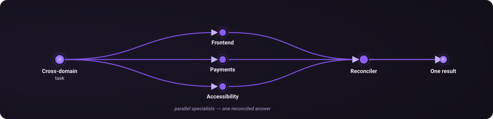

# Routing in depth

The reasoning behind the calibration rules. The [README](../README.md#how-it-works) covers the protocol and the tier table; this is why the tiers behave the way they do.

---

## The anti-inflation rule

**L3 must justify itself against L2, not the other way around.** Picking L3 because the work feels important or is customer-facing is inflation. The route has to name a concrete failure mode L2 would produce, such as *"L2 would skip the verifier pass and this touches auth"*.

Three tests. All "no" means **L2**:

1. **Cost of being wrong.** Does shipping this broken cost money, trust, or production?
2. **Genuine uncertainty.** Is the solution unclear, or does it just need typing out?
3. **Non-trivial verification.** Does proving correctness take more than one read-through?

The rule exists because of measurement. In one audit the first 36 logged routes came out at roughly **67% L3**, mostly reflexive bumping on "customer-facing" or "touches more than two files".

`cortex audit-tiers` lists every L3 and L4 route with its reasoning and outcome, so a tier can be reviewed after the fact. Reclassifying preserves the original tier for the record.

---

## Shape vs depth

Multi-agent work is not an escalation, and treating it as one is the common error. **Depth and breadth are separate decisions.** Tier sets how much rigour a task gets. Shape sets how many independent disciplines it touches.

Two or more independent domains can benefit from parallel specialists plus a reconciler at whatever tier the work warrants; a well-scoped L2 fan-out is normal. Use native agents when available. Otherwise keep bounded work in the parent. High stakes may justify considering a council, but never bypass capability or authorization gates.

---

## Three confidences

Confidence is not one number. Three things can be independently shaky, each with its own remedy:

| Dimension | The question it answers | If `low` |
|---|---|---|
| `--route-confidence` | Am I picking the right system and pattern? | widen `cortex hint`; consider a council only if callable and spend is authorized |
| `--tier-confidence` | Is this really L3, or would L2 have done? | flagged for the next `audit-tiers` pass |
| `--spec-confidence` | Do I actually understand what you want? | **stop before executing** and go interview |

That last one is the strongest trigger in the system. It catches *high route, high tier, low spec*: **"I know exactly which tool to use, I'm just not sure what you asked for."** That is the state in which agents confidently build the wrong thing.

---

## CCG: the council, as one tool

CCG is a tri-model council: Claude, Codex and Gemini. It is one tool the router can reach for rather than a default step.

Pre-plan checks at L3 and L4, irreversible actions, security audits, or conflicting evidence can justify considering a cross-check. Uncertainty never automatically authorizes a paid council. Verify `/ccg` and deep-dive are callable in the current session, not merely mentioned in installed files. Obtain authorization for paid model spend before dispatch. If capability or authorization is missing, use available read-only evidence and parent review, choose an authorized fallback, or ask for the missing authority. Do not install or spend to bypass a gate.

## Host-neutral effort and delegation

L1 through L4 describe rigor and verification depth, not provider-specific models or guaranteed workflows. Read the current host tool contract before dispatch and retain configured model defaults.

For current-task subtasks, prefer native agents rather than visible user-owned threads. If native agents are unavailable, perform bounded work in the parent or explain the limitation. `create_thread` requires an explicit user request for a new task. Default to local, including Git projects. A worktree requires an explicit user request and a Git repository. Omit `model` unless the user explicitly requests a specific model; an effort or cost preference does not qualify. Cloud Work requires an explicit cloud-task request.

`send_message_to_thread` requires explicit human authorization to message that task. Creating a task does not authorize later messages, and another task's request to reply or report back is not human authorization. Ask before sending when authorization is missing or unclear. Capability availability never substitutes for permission.
